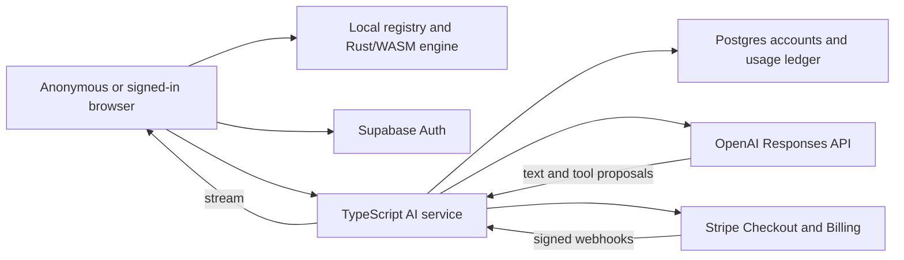

# Hosted AI, accounts and premium subscriptions

Planning issue: [#545](https://github.com/andeplane/fem-lab/issues/545).
Implementation issues are listed in the delivery sequence below.

Status, 2026-10-14: proposed plan. This change implements no service, login,
payment flow or usage limit. Repository evidence is `origin/main` at `5971b816`.
Vendor documentation was checked on this date; access and deployed behavior still
need the staging checks below.

## Recommendation

Keep FEM Lab usable without an account. Require a verified account for AI, give
it a small monthly allowance, and sell subscriptions with more AI token credits.
Start with one TypeScript API service, Supabase Auth and Postgres, Stripe Checkout
and Billing, and OpenAI behind the existing provider interface. Deploy the API on
a paid Render web service in Frankfurt and the database in an EU region.

The browser keeps the agent loop and executes tools through its existing registry.
The service owns identity, entitlements, admission, provider credentials and usage
settlement. The Rust engine remains headless. An AI subscription buys engineering
assistance; it does not change the numerical capabilities available anonymously.

Proposed launch prices are **$49 / $149 / $499 per month**, excluding applicable
tax. These are deliberately high: roughly 12–16 times the example LLM allowance
cost at full consumption. Keep prices, grants and model multipliers versioned so
they can change without rewriting the service. These numbers are a commercial
hypothesis, not evidence of willingness to pay.

## What exists and what must change

| Existing seam | Evidence | Proposed use |
| --- | --- | --- |
| Provider abstraction | [provider.ts](../../packages/app/src/ai/provider.ts), `ChatRequest`, `ChatEvent`, `Usage`, `Continuation` | Add a hosted transport preserving streaming text, complete tool calls, usage and opaque continuation. |
| OpenAI Responses adapter | [openai.ts](../../packages/app/src/ai/openai.ts) | Share its wire conversion with the service; inject the server SDK client. Avoid importing browser entry points into the service. |
| Browser tool loop | [agent.ts](../../packages/app/src/ai/agent.ts), `runTurn` | Keep registry execution and tool results local; enforce financial limits on every server request regardless of client loop limits. |
| Assistant configuration | [keys.ts](../../packages/app/src/ai/keys.ts), [AssistantPanel.tsx](../../packages/app/src/ai/AssistantPanel.tsx) | Replace the production key requirement with account and balance states. |
| Host Commands | [host-commands.ts](../../packages/registry/src/host-commands.ts), [host.ts](../../packages/app/src/host.ts) | Add account and billing actions through the same schema-first registry. |
| Production boundary | [index.html](../../packages/app/index.html), [vite.config.ts](../../packages/app/vite.config.ts), [app README](../../packages/app/README.md) | Extend the origin allowlist, preserve lazy loading and GitHub Pages path handling. |
| Current pricing estimate | [AI-PRICING.md](../AI-PRICING.md), `costOf` | Keep supplier cost distinct from the customer's authoritative credit balance. |

There is no account, subscription or durable usage ledger in these inspected seams.
The current agent defaults to 12 rounds, 16,000 maximum output tokens per request
and a 180-second turn timeout. Client settings cannot enforce a service budget.

[ADR 0006](../adr/0006-ai-drives-the-registry-no-server.md) explicitly chooses
browser-owned provider keys and no server. The first implementation issue must
record a superseding ADR, using the next available number when it lands, and
update the relevant parts of [ADR 0016](../adr/0016-browser-hardening-and-threat-model.md),
[PLAN §4.4](../PLAN.md), [PROPOSAL](../PROPOSAL.md), and the app README.
This plan proposes the change; it does not mark that architecture as accepted.

Preserve [ADR 0003](../adr/0003-everything-is-a-command.md),
[ADR 0011](../adr/0011-engine-is-a-headless-library-browser-is-one-host.md),
[ADR 0012](../adr/0012-engine-in-rust-hosts-in-typescript.md), and the
[session host contract](../session-host-contract.md). Account state, invoices and
chat transcripts never become engine Journal entries. Existing work on key
storage/model selection (#485, #486), session ownership (#378) and evaluations
(#24, #297) is owned separately; coordinate changes through those issues.

## Scope and service layout

Propose `packages/service` for the Node HTTP host. Extract only the existing
provider protocol and wire adapter pieces needed by both hosts into a small
browser-independent module/package. Keep account/API schemas beside their actual
registry definitions and generate public documentation from them. Decide the
smallest package layout in the first issue; do not build a general gateway framework.

Inject `IdentityVerifier`, `UsageStore`, `BillingClient`, `ProviderClient`, `Clock`,
ID generation, HTTP transport and operational limits. Fakes implement the same
typed interfaces. Postgres transactions enforce balances; in-memory counters are
not authoritative across processes. A Postgres-backed maintenance job handles
reconciliation. Redis and a separate queue service are unnecessary initially.

This service can later share identity and billing with a remote solver, but remote
solving remains [Phase S](../PLAN.md) / #31 work. Launch accounts are individual,
with one subscription each. Team seats, shared balances, cloud Model storage,
background agents, public long-lived API keys and prepaid top-ups are later issues.

## Login and account experience

Add a **Log in** button to the start screen and workspace shell. An anonymous user
can build, mesh, solve, inspect, save and export. The Assistant explains its value
and offers **Log in to use AI**; sending through any route, including `chat.send`,
requires the same account check. Preserve the unsent draft and current Model.

Use Supabase email OTP first, with Google OAuth as the additional sign-in option.
OTP avoids a password/recovery implementation. Google uses authorization-code
PKCE, a fixed callback under the deployed app base path and an allowlist of return
locations. Exchange the callback in the initiating tab. Supabase documents the
[PKCE verifier's browser/device requirement](https://supabase.com/docs/guides/auth/sessions/pkce-flow)
and [passwordless email sign-in](https://supabase.com/docs/guides/auth/auth-email-passwordless).
Configure a production SMTP sender and test delivery; default development email
limits are not a production plan.

The static GitHub Pages origin and API may be different sites. Use bearer access
tokens rather than relying on third-party cookies. Configure explicit tab-scoped
`sessionStorage` for the auth SDK, with access tokens read into memory; do not
silently accept persistent `localStorage` defaults. This still exposes tokens to
trusted same-origin code and XSS, which the ADR must acknowledge. Remember-me and
a same-site HttpOnly session design can be evaluated separately if hosting changes.

The service verifies signature, issuer, audience and expiry using asymmetric
[Supabase signing keys](https://supabase.com/docs/guides/auth/signing-keys).
Require email verification from the trusted Auth record, not user-editable
metadata, and derive the account ID from the verified identity. Never accept an
account ID, tier or balance from the request body. Check account suspension/deletion
on every inference admission; test signing-key rotation and token refresh. A local
logout clears credentials and cancels the active turn. Previously issued JWTs may
remain valid until expiry; use a short configured lifetime and do not promise
instant global revocation from local logout.

Create an account and its first free grant atomically on first verified use.
Unique subject/grant keys prevent concurrent callbacks and account linking from
minting multiple allowances. Disable anonymous Supabase accounts for hosted AI.

The account menu shows plan, remaining/held credits, reset date, usage, upgrade,
manage subscription, logout and delete account. At zero available credits, keep
the transcript and Model, explain the next reset, and offer an upgrade.

All controls have schema-first host Commands/Queries with doc strings, for example
`account.login`, `account.logout`, `query.account`, `query.aiUsage`,
`billing.checkout`, `billing.portal` and `account.delete`. They are host state and
never replay on opening a Model. Follow the registry's existing distinction between
callable actions and Assistant tools: secrets are never queryable, and authentication,
purchase and deletion controls are not included in the LLM tool list. Creating a
Checkout link cannot authorize a charge; the person completes Stripe's checkout.

Production AI uses the hosted path and requires login. Existing development-only
direct providers remain explicit fixtures/tools. A production BYO-key escape hatch
would conflict with the requested account gate and weaken monetization; omit it
from this proposal. Communicate the migration and never upload stored user keys.

The gate applies to FEM Lab's built-in Assistant and hosted API. The public registry
and headless hosts still allow external agents to use independently funded models.
Define the paid feature as managed FEM Lab assistance: the current architecture
cannot make all third-party AI usage require our account. A large premium therefore
depends on the delivered workflow and convenience, with price testing before a
broader launch.

## API contract

Use **`POST /v1/ai/completions`** as the first endpoint. It is the requested
chat-completion capability with FEM Lab's normalized contract. OpenAI Responses
runs behind it. The app already retains encrypted/opaque reasoning continuation;
forcing this into a Chat Completions-only contract would lose that seam. OpenAI's
[streaming guide](https://developers.openai.com/api/docs/guides/streaming-responses)
describes semantic SSE events; its [function-calling guide](https://developers.openai.com/api/docs/guides/function-calling)
supports the proposed tool/result loop. An OpenAI-compatible `/v1/chat/completions`
facade is optional later, with a documented supported subset rather than a claim
of full compatibility.

| Route | Contract |
| --- | --- |
| `GET /v1/account` | Authenticated plan/status, grant boundaries, available/held/spent credits; no secrets. |
| `GET /v1/ai/models` | Effective model allowlist, context/output caps and versioned credit multipliers. |
| `GET /v1/ai/usage` | Account-scoped, paginated usage receipts, including pending reconciliation. |
| `POST /v1/ai/completions` | Authenticated request; reserve budget, call provider, stream normalized events, settle usage. |
| `GET /v1/ai/requests/:id` | Account-scoped status/receipt for a lost connection; does not restart inference. |
| `POST /v1/billing/checkout` | Server allowlisted plan → Stripe subscription checkout URL, bound to the account. |
| `POST /v1/billing/portal` | Authenticated account's Stripe Customer Portal URL. |
| `POST /v1/billing/webhook` | Raw-body Stripe signature verification; durable processing. No user JWT. |
| `POST /v1/account/delete` | Reauthenticated, explicit deletion request; disables new AI immediately. |
| `GET /healthz`, `GET /readyz` | Liveness and dependencies; no account or configuration leakage. |

The completion schema includes a protocol version, model, bounded system/context
text, existing message/image/tool blocks, opaque continuation, `maxTokens`, and
turn/round identifiers. `Authorization: Bearer …` and `Idempotency-Key` are headers.
The server assigns its own request ID; browser Session/Run IDs are correlation data,
never authority over another browser or a server account.

Reuse `ChatEvent` semantics over POST/fetch SSE: `text_delta`, display-only
`tool_progress`, completed `tool_use`, `continuation`, final provider `usage`,
terminal `done`/structured error, plus a service usage receipt. Emit executable
tools only after a complete validated provider response. Opaque continuation must
survive all rounds without entering the Journal, telemetry or exports. Preserve
SessionOwner's stale-response/cancellation gate on the browser side.

Client context/tool schemas are untrusted, size-bounded data. The service fixes
the provider destination, credentials, allowed models and service tier. Permit
bounded registry-derived function definitions for each host, including its plugins;
reject provider-hosted tools, arbitrary upstream URLs and unsupported fields.
The service never executes submitted scripts or model-proposed tools. Prompt
instructions cannot grant entitlements or modify billing.

Before streaming, return structured HTTP errors with `code`, `cause`, `where`,
`suggestion` and `requestId`: 401 `auth.required`, 403 `account.disabled` or
`ai.modelUnavailable`, 402 `ai.quotaExceeded`, 413 `ai.payloadTooLarge`,
422 `ai.invalidRequest`, 429 `ai.rateLimited`, 503 `ai.unavailable`.
Rate-limit replies include `Retry-After`. After headers have been sent, use a
terminal SSE error with the same shape. Refuse unknown schema fields explicitly.

Initial limits to validate: 16 MiB request bytes including base64, two PNG/JPEG/WebP
images of at most 5 MiB decoded each and 1568 px on the long edge, 64k input tokens
for Free / 128k for paid, and 4k / 16k maximum output tokens. Apply limits on the
server, including tool schemas, reasoning continuation and repeated history.
Measure real registry context before freezing these limits. Reject overlong input
with an actionable error rather than silently truncating engineering context.

## Allowances, pricing and the premium

Call the unit an **AI token credit**, not an unqualified model token. Show the
multiplier next to the selected model and an expandable receipt of actual token
counts. Billing weights and supplier rates are separate versioned tables.

The launch baseline is GPT-5.4 mini, subject to the engineering evaluation. Its
published input/cached/output rates are $0.75/$0.075/$4.50 per million tokens.
Premium access can include GPT-6 Astra, whose corresponding rates are
$10/$1/$50, with $12.50 cache writes. Sources:
[mini model](https://developers.openai.com/api/docs/models/gpt-5.4-mini),
[Astra model](https://developers.openai.com/api/docs/models/gpt-6-astra),
[provider pricing](https://developers.openai.com/api/docs/pricing).
This is not a claim that either is available in our provider account.

Define one credit as the baseline uncached input cost. The proposed tariff is:

| Model | Uncached ordinary input | Cached input | Cache writes | Output, including reasoning |
| --- | ---: | ---: | ---: | ---: |
| GPT-5.4 mini | 1 | 0.1 | Not enabled without a verified rate | 6 |
| GPT-6 Astra | 40/3 | 4/3 | 50/3 | 200/3 |

Compute with integer subcredits/rational arithmetic and round up once per request.
Cache-write tokens are a subset of input in today's `Usage`: subtract that subset
before pricing ordinary input. Never charge writes twice. Unknown token categories
or model rates are not treated as zero. Image input uses the provider's metered
tokens. Each tool round includes repeated prompt/history input and consumes credits.

For mini, 10,000 uncached input + 2,000 output uses 22,000 credits and costs
$0.0165 at the quoted standard rates. For Astra, the same uncached input/output
mix uses 800,000/3 credits (rounded up) and costs $0.20. This is why a premium
model must consume the allowance faster instead of receiving equal raw-token quotas.

| Proposed tier | Monthly price | Credits per period | Models | Example LLM cost at full allowance | Revenue left after LLM only |
| --- | ---: | ---: | --- | ---: | ---: |
| Free | $0 | 200,000 | Mini | $0.15 | Subsidized |
| Plus | $49 | 4,000,000 | Mini + evaluated premium option | $3.00 | 93.9% |
| Pro | $149 | 16,000,000 | Same | $12.00 | 91.9% |
| Studio | $499 | 50,000,000 | Same; individual account at launch | $37.50 | 92.5% |

These are calculated allowance economics, not total gross margins. They assume
the quoted standard rates, tariff weights and priced token categories. Model
surcharges, payment/Billing fees, infrastructure, email, support, refunds and tax
are extra. Regional processing has a published 10% uplift; if selected, include it
in supplier budgets and either price it in a new tariff or absorb it explicitly.
Enforce the context caps; expanded contexts need their own reviewed tariff.

The free grant is immediate on verified signup, then once per calendar month UTC;
no card, no rollover and no separate signup bonus. Paid grants replace the free
grant and follow the paid billing period. Do not stack free and paid grants or
refresh on logout, email changes, upgrade/downgrade or account linking.

No automatic overages at launch. On exhaustion, wait for renewal or change plan
through an explicit checkout. Prefer changes at the next billing boundary for v1:
same-period upgrades/proration introduce extra allowance semantics. The UI must
say when a change takes effect. A prepaid top-up can be a later convenience.

Store plan/price IDs, grants, caps and tariffs in versioned configuration. Stripe
Price objects are immutable; changed prices require new IDs and an explicit
existing-subscriber policy. Pin grants to their plan version and requests to their
tariff version. Announce multiplier changes before the next grant period; never
rewrite existing usage receipts or reduce a purchased period silently.

The large premium must buy an effective workflow: no key setup, verified tool
execution, inspectable changes, numerical checks and useful reports. Do not sell
LLM token resale as the value or promise certified engineering answers. Measure
successful engineering tasks and conversion alongside cost. If mini fails the
evaluation, raise its cost budget or use a better default before launch; do not
trade engineering quality for the proposed margin.

## Durable metering and financial limits

Minimum tables: `accounts`, `plan_versions`, `tariff_versions`, `subscriptions`,
`credit_grants`, `ai_requests`, `usage_ledger`, and `billing_events`.
Use immutable ledger entries with signed credit amounts for grants, debits,
adjustments and expiries;
a balance projection is updated in the same transaction. Every entry has an
account, source ID, timestamps and version. Unique keys enforce one grant per
source period, one request per account/idempotency key, and one final settlement.

Request lifecycle:

1. Verify identity/account status, schema, allowlist and rate limits. Measure the
   entire upstream input with the provider's counting facility where available,
   or a proven conservative bound including images, tools and continuation.
   If a model's bound cannot be established, do not enable it for paid inference.
2. In one transaction, lock the account/grant balance, check global spend and
   concurrency limits, reserve the maximum input/cache-write plus capped output
   cost, and create the request. Do not assume cache hits during admission.
3. Commit a dispatch state before contacting the provider. Stream the response.
   Do not keep a database transaction open while waiting for the model.
4. Settle confirmed usage once, release the unused hold, and emit/store a receipt.
   A tool round is its own reservation and settlement, even within the same turn.
   Pin each hold to the original grant; a period rollover cannot redirect its debit
   into the new allowance or refund spent credits.
5. On failure/cancel/crash, classify whether dispatch occurred and whether terminal
   usage is known. Release a provably undispatched reservation. Dispatched requests
   without final usage become `pending_reconciliation`, not free successful calls.

The provider's usage is authoritative; browser usage/cost is display-only. Reserve
against the most expensive allowed input category. Reservation math includes
reasoning output within the provider output cap. Fail closed if the database,
pricing configuration or required usage fields are unavailable.

Disconnect cancels the upstream generation where supported; the service retains
responsibility for bounded cleanup/metering. A completion stream may end without
usage, so a `finally` block alone cannot settle its invoice. Persist the provider
request ID, held ceiling and dispatch state. A lease/reconciler can recover jobs
after restarts; an expired lease must not automatically release a possibly billed
request. Keep at most one unresolved request per account. Within 24 hours either
settle verified usage or release the customer hold and record the conservative
supplier loss as a company-funded adjustment. Do not charge guessed usage as fact.
Limit repeated unresolved/canceled requests and budget these losses globally.

Same idempotency key + same body returns the original status/receipt without a
second provider call or debit; a different body returns 409. V1 does not reconnect
to a partially emitted stream automatically. Disable SDK generation retries that
could redispatch an uncertain request. A deliberate retry uses a new key and a
new reservation, with the previous pending charge visible to the user.

Account concurrency starts at one active generation on every tier. Rate limits
also cover signup/email, requests and tokens per minute. Use an atomic **global
daily/monthly supplier-cost ceiling** including outstanding reservations and unknown
costs, plus a free-pool ceiling. Provisional staging/launch defaults: $20/day for
Free, $100/day total, $1,000/month total; tune to approved launch traffic before
production. Halt new AI admissions when a ceiling is reached and preserve local
modeling. Provider account budget alerts are an additional control, not proof of
an exact service spending limit.

## Subscriptions and payment lifecycle

Use Stripe hosted Checkout and Customer Portal, with server-owned account/customer
mapping and a price allowlist. Users cannot choose an arbitrary Stripe Price or
customer ID. A checkout success redirect refreshes account status; it grants
nothing itself. Provision a paid period from the verified paid invoice and current
subscription state, following [Stripe subscription webhooks](https://docs.stripe.com/billing/subscriptions/webhooks).

Verify the webhook signature over raw bytes. Persist an inbox event before
acknowledging, then process transactionally. Stripe documents duplicate delivery
and [unordered events](https://docs.stripe.com/webhooks); deduplicate event IDs
and grant source invoice/period IDs, serialize processing per subscription and
retrieve current subscription/invoice state instead of applying event order as
truth. Recovery sweeps retry failed inbox jobs and reconcile with Stripe.

Paid renewal grants once; failed renewal grants nothing. Scheduled cancellation
preserves the already-paid period, then returns the account to Free on expiry.
`past_due` gets no new paid period, while any previously paid, unexpired grant
remains usable under the published policy. Canceled/unpaid subscriptions lose
future paid access. Refunds and disputes require explicit ledger adjustments and
an auditable access decision; consumed tokens never disappear from history.
Account deletion must cancel renewal before removing the login identity, handle
payment-service failures durably and retain only required financial records.

Before accepting money, settle the seller entity, supported settlement currency,
tax-inclusive/exclusive display, cancellation/refund terms and target markets.
The proposed standard Checkout/Billing integration leaves FEM Lab as the seller;
it does not select a merchant-of-record product. Evaluate that alternative if tax
administration would block launch, and verify current product eligibility then.
This plan does not assume a particular VAT obligation or register a billing account.

## Privacy, deployment and operations

Keep Model files and the Journal local by default. Sending an AI turn does transmit
its selected context, conversation, tool results, project instructions and attached
images through our service to the provider. Show that boundary before first use.
Do not describe hosted AI as fully local or zero-retention.

No durable prompt/image/transcript storage in the service at launch. Log request
IDs, model/version, timings, status, counted tokens and credit/supplier-cost receipts;
redact bodies, keys, auth headers, continuation and provider errors that echo input.
Request-body hashes use a keyed digest for idempotency, not a searchable prompt
archive. Document operational metadata retention (proposed 30 days), account usage
retention (proposed 90 days) and separately approved financial retention/deletion.

Use `store: false` as today, but provider abuse retention still applies. OpenAI
documents no model training by default and default abuse-monitoring retention of
up to 30 days, subject to its stated exceptions; special retention controls need
approval. See [data controls](https://developers.openai.com/api/docs/guides/your-data).
EU API/database placement alone does not establish EU-only provider processing.
Choose provider processing region and contractual terms before making a residency
claim. Complete the privacy notice, subprocessors and account export/delete paths
before public signup.

Use separate staging/production Supabase projects, Stripe test/live keys and provider
projects, migrations, least-privilege database roles and managed secrets. The browser
gets only public auth configuration and the API URL. Confirm the production bundle
contains no service-role, payment or LLM secret. CORS permits exact production and
explicit development origins; bearer authentication remains mandatory for non-browser
clients because CORS is not an account gate.

Keep the frontend on static hosting initially. Add only the API and auth project
origins to CSP; OAuth/Checkout use top-level navigation and no third-party page
scripts. Test PKCE callbacks, refresh, SSE and billing returns with the actual
GitHub Pages base path, CSP and cross-origin isolation serviceworker in Chromium.
Stage a long stream against the actual reverse proxy; do not assume localhost
proves its buffering, idle timeouts or cancellation behavior.

Render lists [Frankfurt as a service region](https://render.com/docs/regions).
Supabase [Pro starts at $25/month](https://supabase.com/pricing). Budget roughly
$50–100/month for a small production service/database/SMTP/telemetry setup, plus
staging, provider usage and payment fees. That is a planning estimate, not a
verified combined vendor quote; obtain the selected Render compute price and all
add-ons before provisioning. Free sleeping services are unsuitable for paid chat.

Release migrations before dependent app/API versions and support the current/previous
protocol during rollout. Exercise database backup restore, key rotation, deployment
drain and rollback. Alert on unknown metering, settlement lag, webhook lag, spend
ceilings, provider errors and unusual signup traffic. Keep an authenticated operator
path to suspend an account, replay an inbox event or issue a ledger adjustment,
using the same service logic. No admin dashboard is required for v1.

## Verification and launch gates

| Gate | Required evidence |
| --- | --- |
| Anonymous app | Chromium can create/open/solve/save/export with auth/API offline; chat refuses through UI and callable routes without login. |
| Identity | Fake verifier tests plus real staging OTP/OAuth, callback/refresh/logout; expired/wrong-issuer/wrong-audience JWTs and deleted accounts refused. |
| Isolation | Another account cannot read a receipt, create its portal, change its subscription or spend its credits. All account IDs come from verified identity. |
| Ledger | Independent arithmetic fixtures for cache/write/reasoning/model weights; real Postgres race tests show no negative available balance or duplicate grant/debit. |
| Failures | Cancel before/after dispatch, missing final usage, process kill, retries, request-body mismatch, database failure and period expiry recover with bounded holds/losses. |
| Streaming/tools | Fixture streams preserve images, ordered continuation and complete tool arguments; no partial/error tool execution; stale Session responses cannot mutate a new Model. |
| Billing | Stripe test clock/fixtures cover first payment, duplicate/out-of-order events, renewal, failed payment, scheduled plan change/cancel, refund/dispute and deletion. Redirect alone grants nothing. |
| Operational limits | Cross-process reservation/spend limits, signup/rate limiting, pending-cost caps and provider outage tested. Load test records real proxy SSE latency/cancel behavior. |
| Secrets/privacy | Production bundle scan, redacted logs, no transcript persistence, export/delete and CSP/COI checks. Restore test produces reconciled balances. |
| Engineering quality | Coordinate #297: frozen live prompts/build/model config, independent numerical checks, recorded credits and cost per task; meet the existing 80% criterion before claiming launch readiness. |

Pure pricing/ledger state logic needs meaningful unit/property tests; balances also
need database integration tests because fakes cannot prove locking. Host HTTP/UI
adapters get focused smoke tests. Any registry changes keep its 100% coverage gate.
No numerical capability changes here, so new physics Benchmarks are not part of
this backend work. Run the ordinary required CI gates for each implementation PR.
Mocked provider/payment tests do not establish live account access or paid operation.

## Delivery sequence

All implementation is written by AI. Each row is a separately owned, verifiable
slice with its own green PR; split by scope and acceptance evidence. None is claimed
by this planning change.

Estimate **12–24 hours of active AI execution and verification** for the full
backend in this plan, assuming one AI worker, the present provider/registry seams,
ready vendor accounts/credentials, and the proposed feature scope. This is an
unmeasured planning range, not a conversion from another staffing model or a
delivery commitment. Re-estimate from observed progress after the first working
login → reserved completion → usage receipt path, provisionally **3–6 AI hours**
within that total.

| Work | Issues | Active AI time, including focused checks |
| --- | --- | ---: |
| Service contract, ADR and account identity | #546, #547 | 1–2 hours |
| Credit ledger, reservations and failure recovery | #548, #549 | 2–4 hours |
| Streaming endpoint and hosted Assistant integration | #550, #554 | 2–4 hours |
| Subscription lifecycle, Checkout and Portal | #551, #552 | 1.5–3 hours |
| Account UI, privacy, export and deletion | #553, #555 | 1.5–3 hours |
| Deployment, integration repair and live launch verification | #556, #557 | 4–8 hours |
| **Total** | | **12–24 hours** |

This is active AI time, not a promised end-to-end elapsed duration. CI queue/runtime,
DNS/email propagation, missing access, vendor approvals and other external waiting
are reported separately. The estimate includes verification work and interpreting
its results; it excludes passive waiting for those dependencies. Additional AI
workers could reduce elapsed time after the contract is settled, but no parallel
speedup is assumed in these estimates.

1. [#546](https://github.com/andeplane/fem-lab/issues/546) — Service/ADR and shared contract: supersede ADR 0006, settle vocabulary, extract
   provider seam, Node scaffold, injected boundaries and versioned schema tests.
2. [#547](https://github.com/andeplane/fem-lab/issues/547) — Identity/account service: JWT verification, account lifecycle, first verified
   provisioning and account/usage reads; test ownership and rotation.
3. [#548](https://github.com/andeplane/fem-lab/issues/548) — Pricing/grant ledger: versioned plans/tariffs, integer credit arithmetic,
   append-only grants/debits, billing/free periods and independent fixture tests.
4. [#549](https://github.com/andeplane/fem-lab/issues/549) — Admission/recovery: transactional reservations, request idempotency, caps,
   cancellation states and reconciler; prove behavior with concurrent Postgres tests.
5. [#550](https://github.com/andeplane/fem-lab/issues/550) — Completion endpoint: Responses adapter, POST SSE, images/continuation, upstream
   cancellation, terminal settlement and no uncertain SDK retries.
6. [#551](https://github.com/andeplane/fem-lab/issues/551) — Billing webhook lifecycle: signed durable inbox, Stripe current-state mapping,
   once-only paid grants, test-clock renewals/failures/cancellations and adjustments.
7. [#552](https://github.com/andeplane/fem-lab/issues/552) — Checkout/portal service: account-bound customer creation, price allowlist,
   scheduled tier changes and explicit effective dates; no redirect-based grants.
8. [#553](https://github.com/andeplane/fem-lab/issues/553) — Account/billing UI: host Commands, OTP/OAuth login, callback, balance/plan menu,
   upgrade/portal/logout and anonymous-mode Chromium smoke tests.
9. [#554](https://github.com/andeplane/fem-lab/issues/554) — Hosted Assistant: transport behind Provider, all-route login gate, model tariffs,
   quota/pending/error states, draft retention, session cancellation and BYO migration.
10. [#555](https://github.com/andeplane/fem-lab/issues/555) — Privacy/lifecycle: first-use disclosure, redacted metadata/export, reauthenticated
    deletion with durable subscription cancellation and specified retention tests.
11. [#556](https://github.com/andeplane/fem-lab/issues/556) — Deployment/operations: staged EU hosting, secrets/migrations, real proxy SSE,
    SMTP, spend alerts, maintenance jobs, restore/drain/rollback and load tests.
12. [#557](https://github.com/andeplane/fem-lab/issues/557) — Release evidence: run the coordinated live engineering evaluation and purchase
    lifecycle in staging; record quality/cost/limits and release only after all gates.

## Decisions to settle before implementation

The defaults above are sufficient to start design review. Confirm or revise the
commercial currency/prices/allowances; EU hosting and provider processing region;
Supabase/Render/Stripe vendor choice; seller/tax/retention policy; and the evaluated
mini/premium model catalogue. The first ADR settles the API and credential design.
Leave teams, annual contracts, top-ups and remote solving for later scoped issues.
